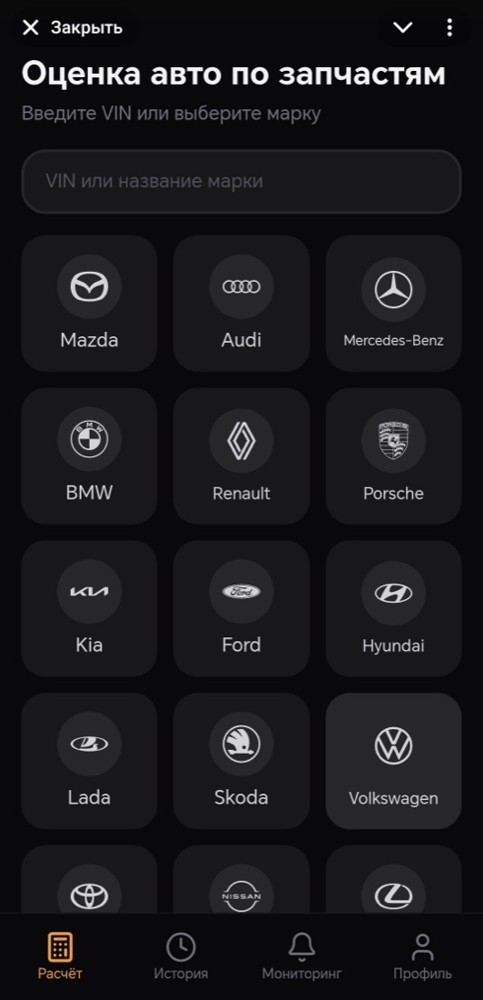
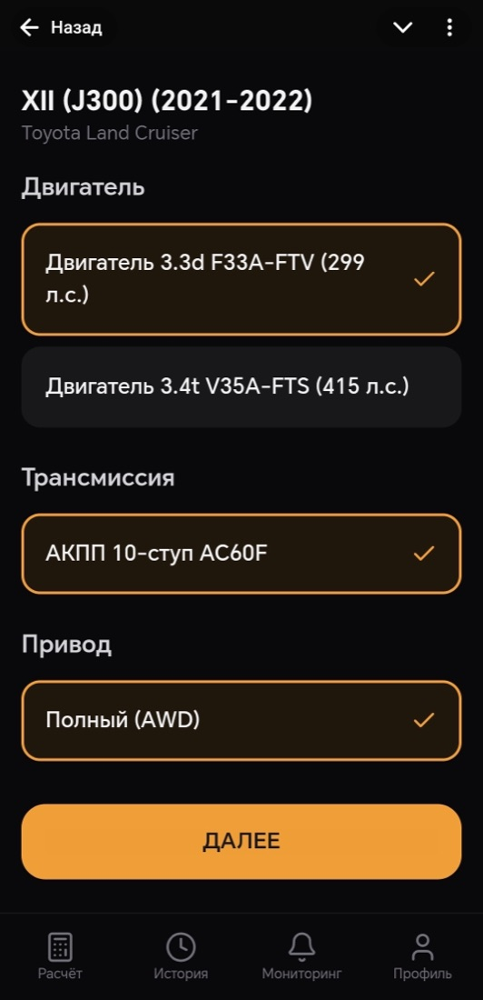
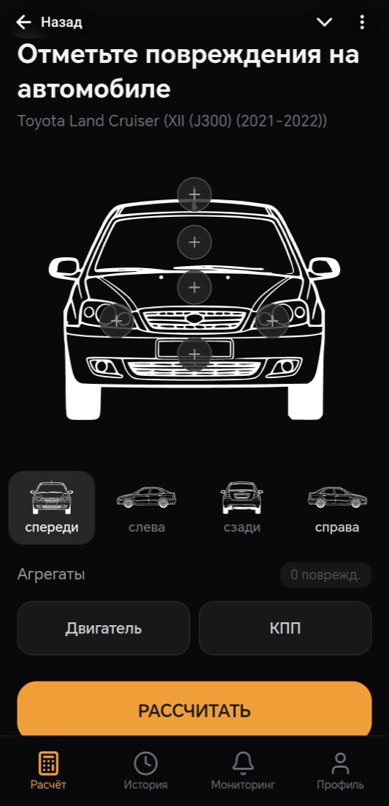
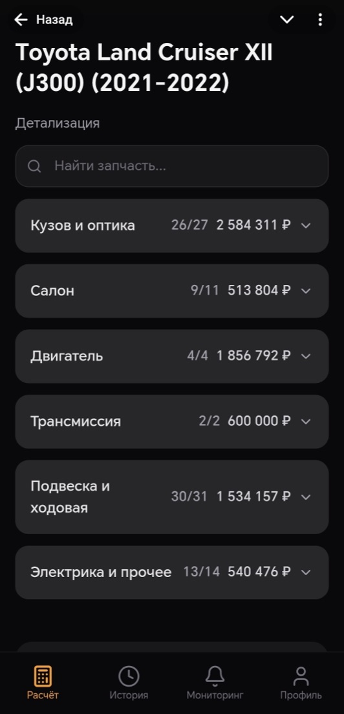
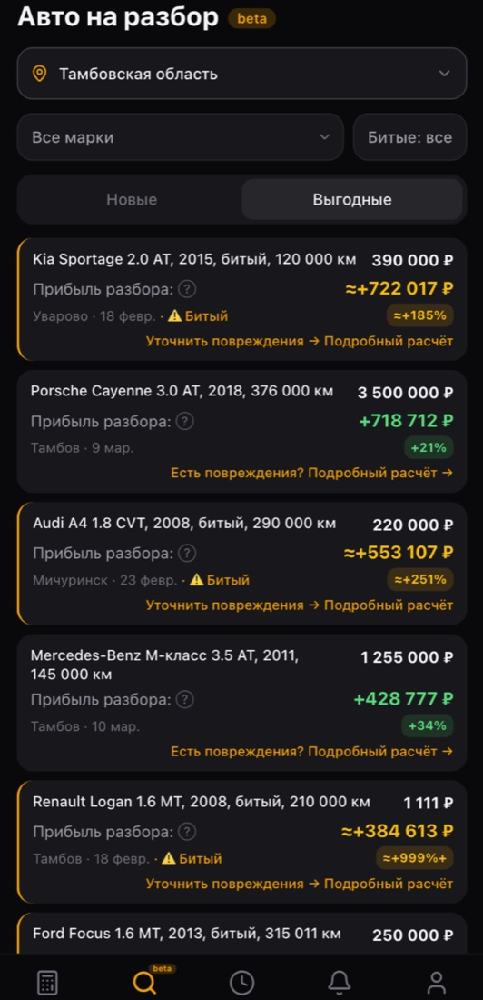
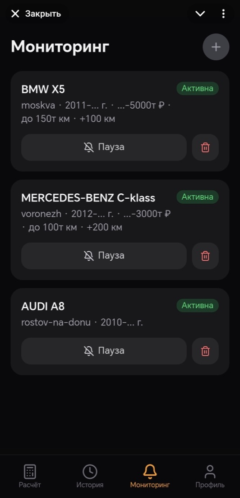
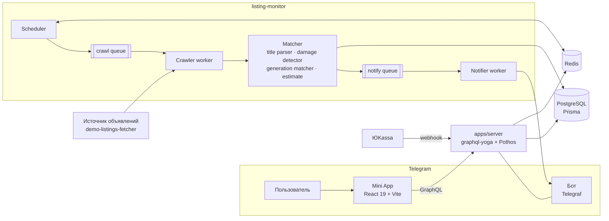

# Razbor

Telegram Mini App для авторазборщиков: за минуту показывает, сколько можно заработать, если купить машину и продать её по запчастям, и присылает в Telegram свежие объявления о продаже авто, которые выгодно взять в разбор.

> **Витринная версия.** В этой версии модуль сбора объявлений и цен с внешних площадок заменён демо-источником с тем же интерфейсом (`apps/listing-monitor/src/providers/demo-listings-fetcher.ts`), поэтому проект запускается локально без внешних сервисов.

<table>
  <tr>
    <td align="center"><br /><sub>Марка или VIN</sub></td>
    <td align="center"><br /><sub>Комплектация</sub></td>
    <td align="center"><br /><sub>Схема повреждений</sub></td>
  </tr>
  <tr>
    <td align="center"><br /><sub>Стоимость по группам деталей</sub></td>
    <td align="center"><br /><sub>Лента выгодных авто</sub></td>
    <td align="center"><br /><sub>Мониторинг объявлений</sub></td>
  </tr>
</table>

## Что умеет

- **Оценка авто под разбор.** Марка → модель → поколение → комплектация (двигатель, КПП, привод) → отметка повреждённых зон на схеме кузова. На выходе стоимость каждой уцелевшей детали, итог и разброс по рынку.
- **Мониторинг объявлений.** Пользователь задаёт фильтры (модель, город, цена, год, пробег), сервис следит за новыми объявлениями и присылает их в Telegram с готовой оценкой прибыли.
- **Региональная лента.** Сплошной обход регионов, поиск битых и аварийных авто, сопоставление с поколением из каталога и расчёт выгоды для каждого объявления.
- **Подписки и оплата.** Пробный период, лимиты расчётов и слотов мониторинга, автопродление и привязанные карты через ЮKassa.
- **Админка внутри Mini App.** Пользователи, платежи, подписки, рассылки, логи мониторинга, Bull Board для очередей.

## Архитектура



Монорепозиторий на pnpm workspaces + Turborepo:

| Пакет | Что внутри |
|---|---|
| `apps/mini-app` | Telegram Mini App: 17 пользовательских экранов и 9 экранов админки, shadcn/ui, Tailwind 4, HashRouter, lazy-роуты |
| `apps/server` | HTTP-сервер: GraphQL, webhook бота, webhook ЮKassa с проверкой IP, cron автопродления, `node:cluster` |
| `apps/listing-monitor` | Мониторинг объявлений на BullMQ: планировщик, воркеры обхода, матчинг, уведомления, Bull Board |
| `packages/api` | GraphQL-схема на Pothos (code-first, type-safe), бизнес-сервисы: оценка, подписки, лимиты, VIN-декодер |
| `packages/db` | Prisma: 19 моделей, миграции, сид каталога на 60+ моделей авто |
| `packages/hooks` | React-хуки на TanStack Query поверх сгенерированного клиента |
| `packages/graphql-client` | GraphQL Codegen: типы и документы для фронтенда |
| `packages/cache` | Кэш на ioredis |
| `packages/shared` | Общие константы, маппинги марок и моделей, парсер поисковых ссылок |

## Интересные места в коде

- **Оценка разбора** — [`packages/api/src/services/estimation.service.ts`](packages/api/src/services/estimation.service.ts), [`utils/aggregate-prices.ts`](packages/api/src/utils/aggregate-prices.ts). Список деталей поколения, исключение повреждённых зон и выбранных пользователем позиций, агрегирование цен. Цены на общие агрегаты (двигатели, КПП) хранятся один раз и переиспользуются несколькими моделями.
- **Разбор заголовка объявления** — [`matcher/title-parser.ts`](apps/listing-monitor/src/matcher/title-parser.ts). Из строки вида «Toyota Camry 2.5 AT, 2012, 180 000 км» достаёт марку, модель, объём, КПП, год и пробег.
- **Детектор битых авто** — [`matcher/damage-detector.ts`](apps/listing-monitor/src/matcher/damage-detector.ts): по параметрам объявления и по регуляркам в тексте («после ДТП», «не на ходу», «под разбор»).
- **Приоритизация регионов** — [`workers/region-prioritizer.ts`](apps/listing-monitor/src/workers/region-prioritizer.ts). Какой регион обходить следующим, решается по давности последнего успешного обхода, числу ошибок подряд и количеству новых объявлений.
- **Дедупликация** — [`storage/deduplicator.ts`](apps/listing-monitor/src/storage/deduplicator.ts), [`region-deduplicator.ts`](apps/listing-monitor/src/storage/region-deduplicator.ts): уже виденные объявления хранятся в Redis с TTL, первый прогон не спамит пользователя.
- **Платежи** — [`apps/server/src/payments/yookassa-webhook.ts`](apps/server/src/payments/yookassa-webhook.ts) и [`yookassa-webhook.service.ts`](packages/api/src/services/yookassa-webhook.service.ts): проверка IP-диапазонов ЮKassa, идемпотентная обработка статусов, автопродление по сохранённому методу оплаты.
- **Авторизация** — [`apps/server/src/auth.ts`](apps/server/src/auth.ts): проверка подписи Telegram `initData`.

## Стек

**Frontend:** React 19, Vite 6, TypeScript, Tailwind CSS 4, shadcn/ui, TanStack Query, GraphQL Codegen, Telegram WebApp SDK
**Backend:** Node.js 20, graphql-yoga, Pothos, Prisma, PostgreSQL 16, Redis 7, BullMQ, Telegraf, ЮKassa API
**Инфраструктура:** Docker, Docker Compose, Nginx, Traefik, Dokploy
**Тесты:** Vitest (unit), Playwright (10 e2e-сценариев: бесплатный пользователь, подписка, оплата, история, лимиты)

## Запуск

Нужны Docker и Node.js 20+ с pnpm 9.

```bash
cp .env.docker.example .env.docker
cp .env.example .env
pnpm install
pnpm docker:dev:build
```

После старта:

- Mini App — http://localhost:3000
- GraphQL — http://localhost:4000/graphql
- Bull Board мониторинга — http://localhost:3001

Схему и тестовые данные можно накатить заново:

```bash
pnpm db:migrate
pnpm db:seed
```

В dev-режиме Mini App открывается в обычном браузере. Функции, привязанные к пользователю (история, мониторинг, подписка), проверяют подпись Telegram, поэтому для них нужен `BOT_TOKEN` своего тестового бота.

## Проверки

```bash
pnpm build
pnpm test
pnpm test:e2e
```

## Автор

Максим Постика — frontend / fullstack разработчик.
